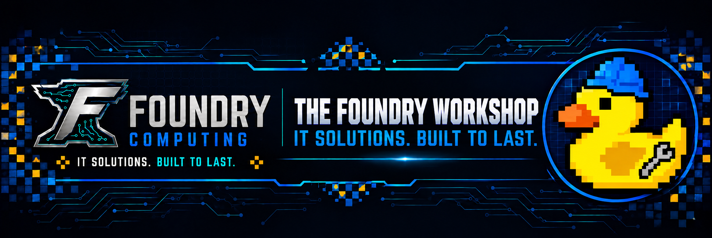

<!-- foundry-brand:start -->

A project by [Foundry Computing](https://github.com/Foundry-Computing) · **IT solutions. Built to last.**

Meet **Foreman**, the workshop duck with a blue hard hat and spanner.
<!-- foundry-brand:end -->

# Foundry Computing Organization Governance

This repository owns the public organization profile, reusable community
health files, agent guidance, and governance reports for Foundry Computing.

Repository-specific instructions take precedence where they impose stronger
requirements.
