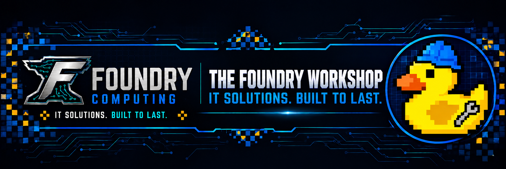

<!-- foundry-brand:start -->

**IT solutions. Built to last.** Meet **Foreman**, our workshop rubber duck.
<!-- foundry-brand:end -->

# Foundry Computing

We create tools, stories, and experiences that help people preserve knowledge,
repair what they value, and strengthen their communities.

FORGE is Foundry's AI operations, repair, guidance, and engineering system. It
is being developed as a local-first, open-source foundation that keeps policy,
context, provider access, and user control at explicit boundaries.

Current project areas include:

- Forge Core coordination and client APIs
- Foundry AI Gateway provider normalization
- PowerShell and Visual Studio Code clients
- local specialist models and knowledge tools
- repair, workshop, storytelling, and community-support software

Active development is organized through GitHub Issues and the Foundry
Development project. Significant changes are reviewed, validated, and recorded
before release.

## FreeBSD virtual graphics research

Follow [our FreeBSD vmwgfx porting experiment for Daemonarchy](https://github.com/Foundry-Computing/daemonarchy-vmwgfx). We are documenting reproducible build milestones, native-interface work and the validation needed for a future VMware DRM driver. The driver is incomplete; native Hyprland is not yet working in the tested guest.
